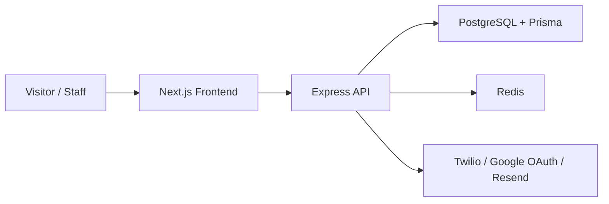

# Velocity

Velocity is a multi-tenant lead recovery and appointment orchestration platform for local service businesses that want to recover missed opportunities without adding more manual work. The product combines a marketing-facing experience, a workspace onboarding flow, and a dashboard for managing leads, appointments, and team access so businesses can respond faster to inbound calls, forms, and SMS conversations.

The current codebase is organized as a decoupled Next.js frontend and Node.js/Express backend, with PostgreSQL and Redis backing the core workspace model. The implementation already includes tenant onboarding, authenticated workspace access, role-based permissions, email verification and password reset, and Twilio webhook-based missed-call and SMS recovery flows.

## Who it is for

Velocity is aimed at service businesses that rely on inbound calls and lead follow-up to generate appointments, such as dental practices, med spas, and other local operations that need a more structured way to recover missed opportunities and manage follow-up conversations.

---

## Tech stack

### Frontend
- Next.js 16 with the App Router
- React 19
- Tailwind CSS
- Framer Motion and Motion
- Radix UI primitives
- Recharts, lucide-react, clsx, Zustand, axios

### Backend
- Node.js 18+
- Express.js with TypeScript
- Prisma ORM
- PostgreSQL
- Redis
- JWT-based authentication
- Passport.js with Google OAuth
- Twilio SDK for voice/SMS webhooks
- Resend for email delivery
- Helmet, CORS, rate limiting, cookie parsing

### Data and integrations
- PostgreSQL via Prisma and the pgvector extension in the schema
- Redis for caching and service health checks
- Twilio for inbound voice/SMS handling
- Google OAuth for sign-in
- Resend for transactional email

---

## Architecture

The repository is split into two main applications:

- A Next.js frontend for public pages, authentication screens, and the internal dashboard
- A TypeScript backend API for auth, tenancy, onboarding, and webhook orchestration

The backend uses a tenant-scoped data model, where each workspace owns its own members, roles, permissions, leads, conversations, and appointments. Authentication is issued with access and refresh tokens, and the tenant middleware resolves workspace context for tenant-scoped requests.



### Key architectural decisions
- Authentication is handled server-side with JWT access tokens and refresh cookies.
- The Prisma schema is built around a multi-tenant model with explicit tenant, tenant member, role, and permission entities.
- Twilio webhooks are the entry point for missed-call and SMS-driven recovery workflows.
- The frontend is intentionally separated from the API layer so the landing experience and internal dashboard can evolve independently.

---

## Features

The current implementation includes the following shipped areas:

- Authentication and account lifecycle
  - Email registration and verification
  - Login and refresh-token handling
  - Password reset and resend-verification flows
  - Google OAuth sign-in
- Tenant and workspace management
  - Tenant creation and onboarding
  - Workspace member invitations
  - Role and permission management
- Dashboard experience
  - Overview screen with summary cards and recent lead activity
  - Leads management UI with search, filtering, sorting, and CSV export
  - Appointments screen with calendar and list views
  - Settings screen for profile and integration preferences
- Lead recovery workflows
  - Twilio voice webhook handling
  - Twilio SMS webhook handling
  - Missed-call recovery with automated outbound SMS follow-up
- Public product experience
  - Marketing landing page
  - About, whitepaper, status, and auth pages

> Note: Some backend route modules such as leads, SMS, and calendar are mounted in the API but are still scaffolded rather than fully wired to live business logic in this snapshot.

---

## Getting started

### Prerequisites
- Node.js 18 or newer
- npm
- PostgreSQL running locally or via Docker
- Redis running locally or via Docker

### 1. Clone and install dependencies

```bash
git clone <repository-url>
cd velocity-lead-recovery-saas

cd backend
npm install

cd ../frontend
npm install
```

### 2. Configure environment variables

Copy the example files and fill in the required values.

```bash
cp backend/.env.example backend/.env
cp frontend/.env.example frontend/.env.local
```

#### Backend environment variables
The backend example file includes:
- `NODE_ENV`
- `PORT`
- `DATABASE_URL`
- `REDIS_URL`
- `ACCESS_TOKEN_SECRET`
- `ACCESS_TOKEN_EXPIRE`
- `REFRESH_TOKEN_SECRET`
- `REFRESH_TOKEN_EXPIRE`
- `RESEND_API_KEY`
- `APP_URL`
- `CORS_ORIGIN`
- `LOG_LEVEL` (optional)

The backend code also expects the following runtime variables in addition to those shown in the example file:
- `GOOGLE_CLIENT_SECRET`
- `GOOGLE_CALLBACK_URL`
- `TWILIO_ACCOUNT_SID`
- `TWILIO_AUTH_TOKEN`
- `TWILIO_PHONE_NUMBER`

#### Frontend environment variables
The frontend example file includes:
- `NEXT_PUBLIC_API_URL`
- `GOOGLE_CLIENT_ID`
- `NODE_ENV`

### 3. Start local services

The repository includes Docker Compose for local PostgreSQL and Redis:

```bash
cd backend
docker compose up -d postgres redis
```

### 4. Run database migrations

```bash
cd backend
npx prisma migrate dev
npx prisma generate
```

### 5. Start the apps

Run the backend:

```bash
cd backend
npm run dev
```

Run the frontend in a second terminal:

```bash
cd frontend
npm run dev
```

The API will be available at `http://localhost:3001` and the frontend at `http://localhost:3000` by default.

---

## Project structure

```text
backend/           # Express API, Prisma schema, services, controllers, middleware
frontend/          # Next.js app, marketing site, auth pages, dashboard UI
prisma/            # Prisma schema and migration history
```

### Key directories
- `backend/src/controllers` — request handlers for auth, tenants, onboarding, and webhooks
- `backend/src/services` — business logic for authentication, tenancy, and Twilio workflows
- `backend/src/routes` — API route definitions
- `backend/prisma` — Prisma schema and migrations
- `frontend/app` — route-based pages for marketing, auth, onboarding, and dashboard screens
- `frontend/components` — shared UI and dashboard components
- `frontend/context` — auth and tenant state providers

---

## API and route overview

The main backend routes are mounted under `/api/v1`:

- `/api/v1/auth` — register, login, verification, password reset, refresh, logout, profile updates
- `/api/v1/tenant` — tenant creation, member invitations, role and permission management
- `/api/v1/webhooks/twilio/*` — inbound voice and SMS webhooks
- `/api/v1/leads` — mounted for future lead management work
- `/api/v1/sms` — mounted for future SMS workflow work
- `/api/v1/calendar` — mounted for future calendar workflow work
- `/api/health` — service health check for backend dependencies

The frontend also exposes the following main routes:
- `/` — public marketing homepage
- `/sign-in`, `/sign-up`, `/forgot-password`, `/reset-password`, `/verify` — authentication flow
- `/onboarding` — workspace setup experience
- `/dashboard` — internal workspace dashboard
- `/dashboard/leads`, `/dashboard/appointments`, `/dashboard/analytics`, `/dashboard/settings` — dashboard modules

---

## Deployment

The repository does not currently include a checked-in deployment configuration for a specific platform such as Vercel, Render, or Fly.io. The implementation is structured as a decoupled frontend and backend application, and the existing environment values point to a hosted backend URL plus a browser-facing frontend origin.

For deployment, the expected setup is:
- Frontend: a Next.js hosting provider for the app directory
- Backend: a Node.js/Express environment with PostgreSQL and Redis available
- Environment variables: wire the same backend and frontend variables into the production environment

---

## Status and roadmap

The current repository shows a working foundation for a multi-tenant SaaS product with authentication, onboarding, workspace management, dashboard UI, and Twilio-based recovery flows. The next steps are to fully connect the dashboard data layer to the Prisma-backed backend and complete the leads, SMS, and calendar modules so the product moves from scaffolded UI and webhook logic to a fully end-to-end workflow.

